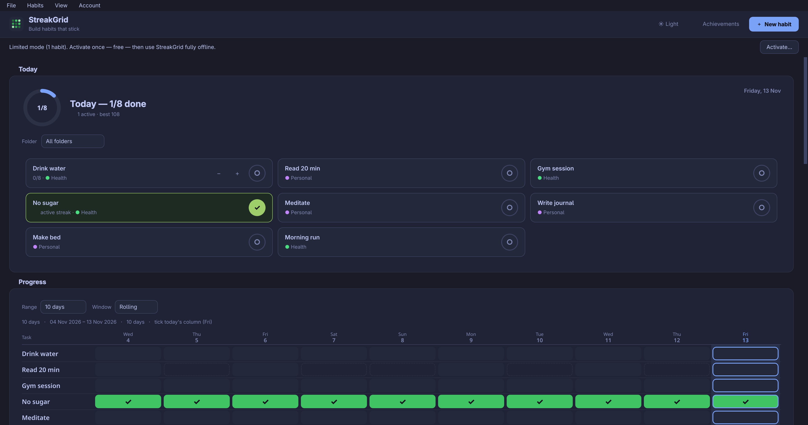
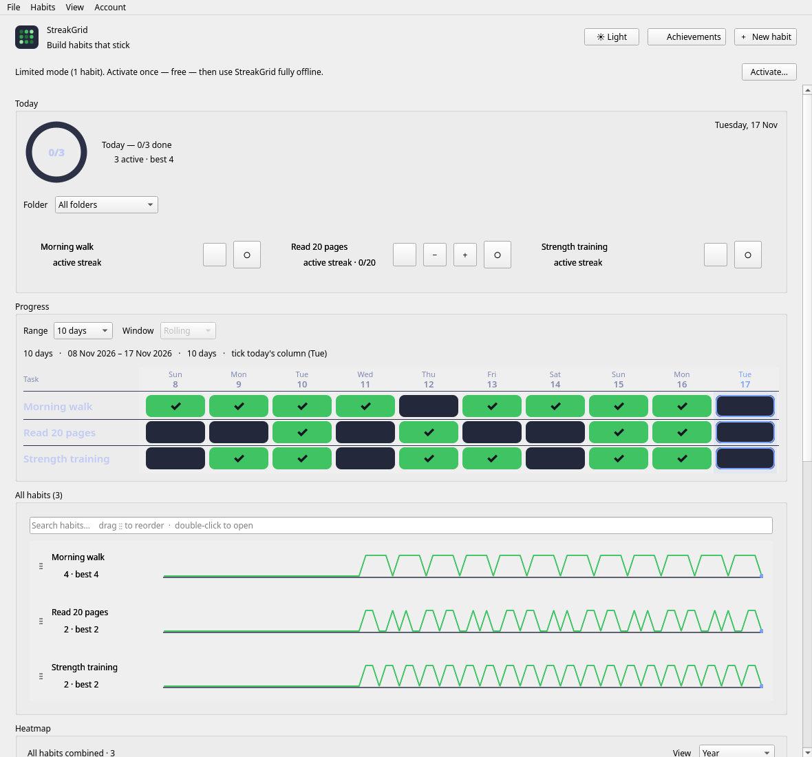
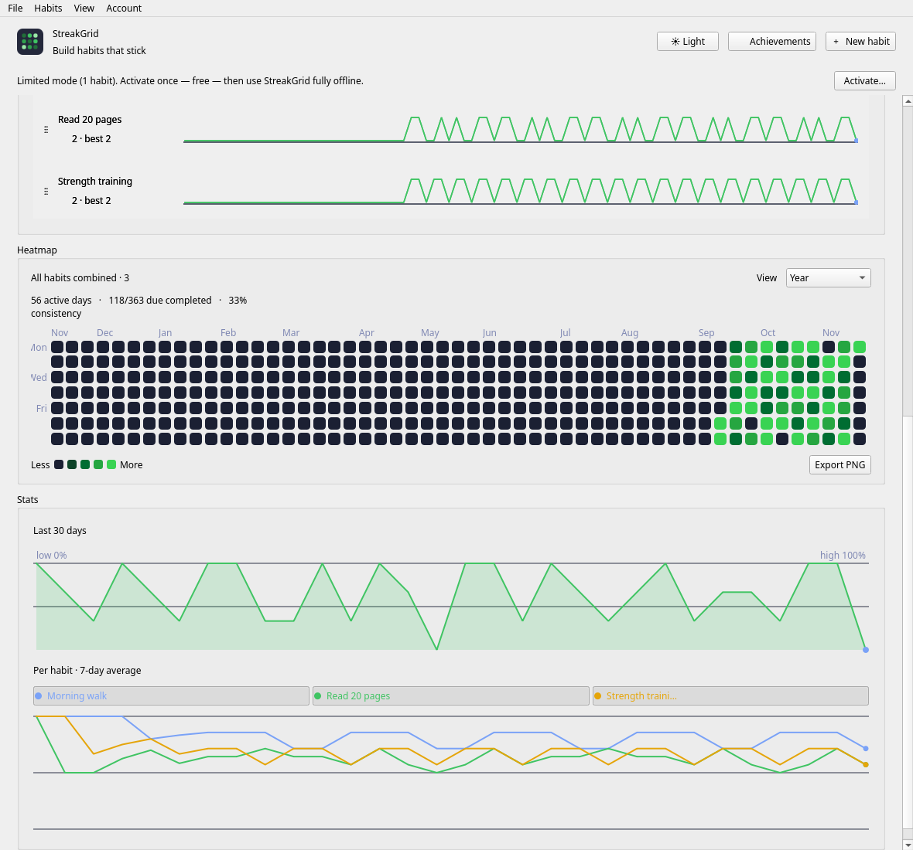

# StreakGrid

A tactical habit tracker with GitHub-style contribution grids, schedule-aware streaks, folders, achievements, reminders and a one-tap desktop widget.



`Python 3.11+` · `PySide6 / Qt 6` · `SQLite` · Desktop app · Linux v1 implemented

## At a glance

| | |
|---|---|
| **Idea** | A habit grid that understands schedules, pauses and partial completions — not just "did you tick it today" |
| **Linux app** | Implemented: Today, Progress grid, All habits, Stats, folders, widget, tray, nag mode, exports |
| **Data** | Local SQLite only; no account, no sync |
| **Scheduling** | Daily, selected weekdays, interval, times per week/month, plus pause windows |
| **Other platforms** | Android and Windows are **planned**; those directories contain only specifications today |
| **Verification** | Linux app launched on this machine; screenshot is a real capture |
| **Role** | Solo — product spec, data model, Linux app, packaging |

## Overview

StreakGrid is built around a stricter definition of a streak than most habit apps. A habit can be scheduled on specific weekdays, every N days, or a number of times per month; it can be paused without breaking the streak; and counter habits (eight glasses of water) can be partially completed. The streak calculation respects all three.

The UI borrows the contribution-grid metaphor: one row per habit, one column per day, with calendar or rolling windows. Today is the only editable column in the progress view — retroactive editing happens deliberately through the habit detail dialog, not by accident.

## Screenshots

| Progress grid | Stats |
|---|---|
|  |  |

## Status by platform

| Platform | Stack | Status |
|---|---|---|
| **Linux** | Python + PySide6 + SQLite | **v1 implemented** — runs, exports, packages |
| Android | Kotlin + Compose + Glance | Specification only (`apps/android/README.md`) |
| Windows | C# + WinUI 3 | Specification only (`apps/windows/README.md`) |

The repository is a monorepo so the shared data model and streak rules can be specified once. Only the Linux client currently backs that claim with code.

## Features (Linux)

- **Today** — progress ring, due habits as cards, counter step-up/step-down.
- **Progress grid** — one row per habit, one column per day; calendar or rolling window; ranges from a week to a year.
- **All habits** — search, drag-to-reorder, folder, streak, best streak, next due date and a yearly mini-grid.
- **Aggregate heatmap** — share of due habits completed per day, with month/weekday axes and consistency summary.
- **Stats** — 30/90/all completion rates, current and best streaks, weighted strength, perfect days, per-weekday chart.
- **Folders** — colour-coded categories with filtering.
- **Desktop widget** — always-available one-tap check-off.
- **Achievements** — eight badges, from First Step to Century Club.
- **Nag mode** — persistent reminder until the habit is completed.
- **Exports** — heatmap PNG, stats CSV, CSV import; database backup and restore.
- **Packaging** — desktop entry and Flatpak manifest.

## Architecture

```text
apps/linux/
  main.py            entry point (PySide6)
  ui/                main window, cards, heatmap, stats, dialogs, theme
  core/              schedule rules, streak calculation, ranges,
                     achievements, heatmap aggregation, entitlements
  db/store.py        SQLite access and migrations
  services/          tray, notifications, nag, backup, autostart,
                     identity, license check, widget registry
  widgets/           desktop widget
core/docs/SPEC.md    frozen schema and date semantics
```

**Data model.** `habits`, `completions`, `folders`, `pauses`, `achievements` in SQLite; dates stored as local `YYYY-MM-DD` text to avoid timezone drift, with `updated_at` in UTC ISO-8601. Completions are unique per habit/day and carry a `value` for counter habits.

**Why a spec first.** The Android and Windows clients are intended to share the same schema and streak semantics. Freezing those rules in `core/docs/SPEC.md` before writing a second client avoids three subtly different definitions of "streak".

## Getting started (Linux)

```bash
git clone https://github.com/amir-khoshdel-louyeh/streak-grid.git
cd streak-grid/apps/linux
python3 -m venv .venv && source .venv/bin/activate
pip install -r requirements.txt
python main.py
```

The database is created at `~/.local/share/streakgrid/streakgrid.db`. A headless smoke check:

```bash
QT_QPA_PLATFORM=offscreen timeout 10 python main.py
```

**Shortcuts:** `Ctrl+N` new habit · `Ctrl+1..5` sections · `/` search · `Ctrl+T` theme · `Ctrl+B` backup.

## Testing

The repository has no committed automated test suite for the Linux client. `pytest` is listed as a development dependency and the core modules (`schedule.py`, `streak.py`, `heatmap.py`) are structured for unit testing, but tests have not been written. The headless offscreen launch is the current smoke check.

## Product constraints

- **Offline-first.** Habit content stays on-device. A one-time activation/unlock flow exists in `services/license_check.py`; no subscription server is required after activation.
- **No account.** Identity is local; there is no cloud sync.
- **Local exports.** PNG/CSV outputs are written to the user's Pictures/Documents directories.

## Limitations

- **Linux only in practice.** Android and Windows are specifications, not clients; the README does not claim cross-platform parity.
- **No automated tests.** Streak and schedule edge cases (DST, pause boundaries, month-end) are the highest-risk untested area.
- **Single-device.** No sync or multi-device conflict handling.
- **Licensing flow is local** and not a hardened entitlement system.
- **Screenshots** show the Linux build; the app was launched once for this capture, not exhaustively tested.
- **Packaging manifests are present but no published Flatpak/desktop package was produced here.**

## Roadmap

- Unit tests for schedule and streak rules, including pause and month-end cases.
- Android MVP sharing the frozen schema.
- Optional encrypted export/import for moving between devices.
- Accessibility pass for keyboard-only navigation and screen readers.

## Repository structure

```text
streak-grid/
├── apps/
│   ├── linux/          # Implemented PySide6 client
│   ├── android/        # Specification (no source yet)
│   └── windows/        # Specification (no source yet)
├── core/docs/          # Frozen schema, streak rules, migrations, licensing
├── assets/readme/      # Screenshot used here
├── PRIVACY.md · TERMS.md
└── server/mock.py      # Mock server for activation experiments
```

## Tech stack

`Python` · `PySide6 / Qt 6` · `SQLite` · `pytest` (development) · Flatpak packaging

## Author

**Amir Khoshdel Louyeh**
[GitHub](https://github.com/amir-khoshdel-louyeh) · [LinkedIn](https://www.linkedin.com/in/amir-khoshdel-louyeh)
